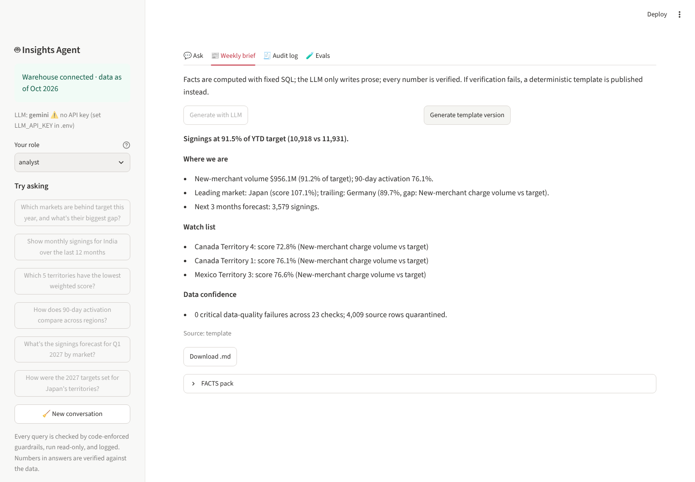
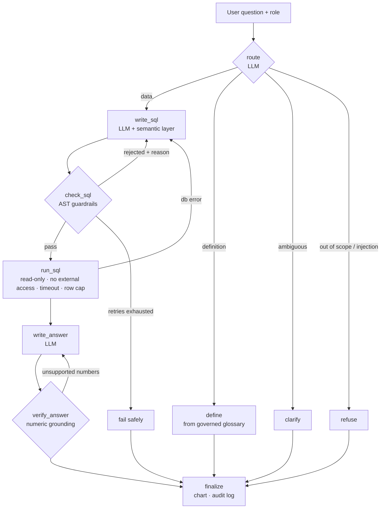

# 🤖 Performance Insights Agent

**A governed AI agent that lets sales leaders ask performance questions in plain English, with every query policed by code, every number checked against the data, and every answer logged.**

> *"Which markets are behind target this year, and what's their biggest gap?"*
> → routes the question → writes SQL from a governed semantic layer → **guardrails validate the SQL AST** → runs it read-only → writes a short answer → **verifies every number in that answer against the result** → draws a chart → logs everything.

Most text-to-SQL demos stop at "the LLM wrote a query". In a regulated company the hard part is **trust**. This project is built around that:

| Risk | Control (enforced in code, not just prompted) |
|---|---|
| LLM writes `DELETE`, `ATTACH`, `COPY`, reads files | AST guardrails (sqlglot): single read-only statement, allow-listed tables, blocked system and file functions, then a **read-only DuckDB connection with external access disabled** as a second line of defence |
| Prompt injection ("ignore your rules and…") | Router refuses out-of-scope requests; injection patterns are flagged in the audit log; even a fully compromised LLM still can't pass the SQL guardrails |
| Employee personal data exposed | **Role-based column policy**: a `viewer` can't select `rep_name`, including through `SELECT *` |
| Hallucinated numbers in the narrative | **Numeric grounding check**: every figure must trace to the result (with rounding, %, $M handling). If not, the answer is regenerated with feedback, then shown with an explicit ⚠️ *Unverified* banner |
| Wrong or inconsistent metric definitions | **Semantic layer** (`config/semantic_layer.yaml`) with one governed SQL definition per metric |
| Bad SQL | **Self-correction loop**: guardrail rejections and database errors go back to the SQL writer (bounded retries), then the agent fails safely rather than guessing |
| Runaway queries | Automatic row cap + query timeout via `interrupt()` |
| "How do we know it works?" | **Evaluation suite**: golden questions scored by *execution accuracy*, behaviour tests, a 24-query red-team set, latency and token tracking |
| Accountability | Append-only **audit log**: who asked, role, SQL, guardrail verdicts, rejected attempts, rows, verified figures, latency, tokens |



## Architecture



Built with **LangGraph** (explicit state machine, bounded loops), **sqlglot** (SQL parsing and policy), **DuckDB** (or BigQuery via the companion project), and any **OpenAI-compatible LLM**: Gemini, Groq, OpenAI or local Ollama, switched with one env var.

## Weekly executive brief: AI-enabled reporting automation

`python -m pia.brief` builds a leadership brief where **the facts are computed by fixed, reviewed SQL and the LLM only writes the prose**. Every number in the draft is verified against the facts pack. If it fails twice, a deterministic template brief is published instead, so the pipeline **never ships an unverified number**.

## Evaluation

```bash
python -m pia.evals.run_evals --offline   # no API key: red-team + reference checks (runs in CI)
python -m pia.evals.run_evals             # full agent eval with your LLM → evals/report.md
```

| Suite | What it measures | Result |
|---|---|---|
| Red-team SQL (24 attacks: DML/DDL, ATTACH, COPY, file reads, `getenv`, CTE shadowing, cross-DB, restricted columns) | guardrail block rate | **100%** |
| 20 legitimate reference queries | guardrail false-positive rate | **0%** |
| 20 golden questions | execution accuracy (result-set match, tolerant to rounding and % scaling) | *run with your key → fill in* |
| 5 behaviour cases | definitions, refusals, injection, viewer privacy | *run with your key → fill in* |
| All answers | grounded-answer rate, p50/p95 latency, tokens/question | *run with your key → fill in* |

The scorer itself is tested: an oracle that returns the reference SQL must score 100% (`tests/test_agent.py`).

## Quick start

```bash
# 1. Build the data platform this agent queries (companion repo)
git clone https://github.com/geniusishan/field-performance-hub ../field-performance-hub
pip install -e ../field-performance-hub && (cd ../field-performance-hub && python -m fph.pipeline run)

# 2. Install and configure the agent (free Gemini key: https://aistudio.google.com/apikey)
pip install -e ".[dev]"
cp .env.example .env        # set LLM_API_KEY

# 3. Use it
streamlit run app/chat.py   # chat · weekly brief · audit log · evals
python -m pia.brief         # brief to briefs/
pytest -q                   # 22 tests, scripted LLM, no key needed
```

## Project structure

```
config/semantic_layer.yaml   tables, grain, columns, governed metrics, rules (the LLM's only view of the data)
config/policy.yaml           allow-listed tables, blocked functions, role column policy, limits
src/pia/
  agent.py                   LangGraph state machine (route → SQL → guard → run → answer → verify)
  guardrails.py              sqlglot AST policy enforcement + row limit injection
  db.py                      read-only connection, external access off, timeout
  grounding.py               numeric hallucination checker
  brief.py                   facts-first executive brief with verified numbers + template fallback
  prompts.py                 prompts assembled from the semantic layer, few-shot examples
  llm.py                     OpenAI-compatible client (Gemini/Groq/OpenAI/Ollama) + FakeLLM for tests
  charts.py                  deterministic chart selection from result shape
  audit.py                   append-only JSONL audit trail
  evals/                     golden set, behaviour cases, red-team SQL, harness and report
app/chat.py                  Streamlit UI with "How I got this" panel (SQL, guardrails, verified figures, trace)
tests/                       22 tests: guardrails, every graph path, privacy, audit, read-only, eval scorer, UI
```

## Design decisions

- **Deterministic where possible, LLM where useful.** Guardrails, grounding, charts, facts and evals are plain code; the LLM only routes, writes SQL and writes prose.
- **Fail closed.** If the agent can't produce a valid, safe query in 3 tries, it says so. It never guesses an answer.
- **Show the work.** Every answer carries its SQL, guardrail checks, verified figures, any self-corrections, and a step-by-step trace, so an analyst can review it before forwarding.
- **Vendor-neutral.** One OpenAI-compatible client means the model is a config choice, so it fits whichever LLM platform an enterprise has approved.

---
*Runs on the synthetic data from [Field Performance Hub](https://github.com/geniusishan/field-performance-hub). No real company or customer data is used.*
